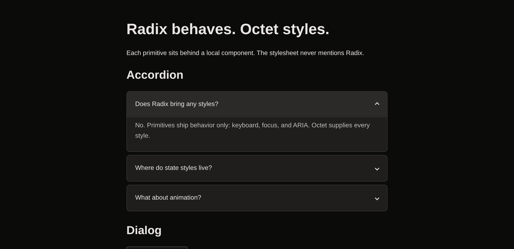
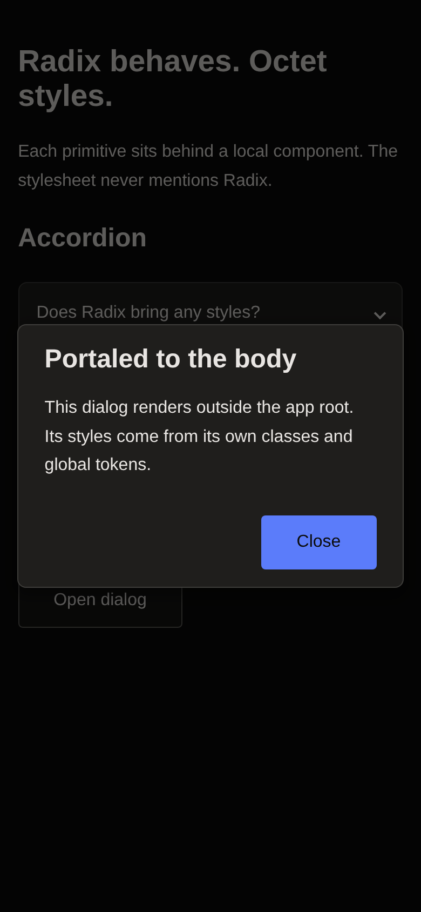

# Recipe: Radix Primitives with Octet

Radix Primitives supply behavior: keyboard handling, focus management, ARIA. Octet supplies every style. *Don't use Radix Themes or any Radix CSS.*

This recipe was built and tested with Octet 0.5.0, Radix Accordion and Dialog 1.3.1, React 19, and Vite 8.



## Should you use Radix?

Octet works well by itself. Add Radix only for the pieces of a page that need real behavior, like an accordion, a dialog, a menu, or a select.

**Good reasons to add it**

- **Behavior you'd otherwise write by hand.** A dialog has to trap focus, return it when it closes, close on Escape, and tell screen readers what it is. An accordion needs arrow-key movement and the right ARIA attributes. Radix does all of it, and it's easy to get wrong on your own.
- **No styles to fight.** The primitives ship without CSS. Octet's tokens apply directly, and you never override a library's look.
- **State on attributes.** Radix marks each part with `data-state`, `data-disabled` and similar. That matches Octet's rule that state lives on attributes, not on `.is-open` classes.
- **Pay for what you use.** Each primitive is its own package. A page with only a dialog loads only the dialog.
- **Easy to swap later.** Every primitive sits behind a local wrapper (rule 1 below), so moving to React Aria touches one folder.

**Costs to know about**

- **React only.** Radix Primitives are React components. Octet itself works with any framework.
- **You write every style.** Nothing looks like an accordion until you style it. Each primitive needs its own small partial, as in the setup below.
- **Extra JavaScript.** The two primitives in this recipe add 18 KB gzipped (see the table below).
- **Portals break parent selectors.** Dialogs, selects, and popovers render outside your app root, so styles can't depend on where they sit in the page.
- **Tested with two primitives.** Accordion and Dialog are verified. The others follow the same rules but haven't been tried.

**Skip Radix if** native HTML covers the job. A plain `<details>` is an accordion, and `<dialog>` is a modal with focus trapping built in. Try those first. Reach for Radix when you need what they lack, like animated open and close, menus, or custom selects.

### Does it add bloat?

Radix is the cost here, not Octet. The same page built twice, with and without the two primitives:

| Build | JavaScript | Gzipped |
| --- | --- | --- |
| React alone | 219.6 KB | 68.6 KB |
| React + Accordion + Dialog | 275.7 KB | 86.4 KB |

So the two primitives add 56 KB raw, 18 KB gzipped. Each primitive is its own package, so you pay only for the ones you import.

The CSS for the whole test page, including Octet's `base` and `components` layers and the six small files below, is 8.1 KB raw and 2.4 KB gzipped.

## Rules

1. **Wrap each primitive in a local component.** The rest of the app never imports Radix directly. Swapping to React Aria later touches one folder.
2. **Style with BEM classes and attribute selectors.** Pass `className` to each Radix part. Radix sets `data-state`, `data-disabled` and `data-orientation`, which fits Octet's rule that state lives on attributes.
3. **Put each rule in the file its property belongs to.** Margin, padding and gap in `_theme-spacing.scss`. Size, flex, grid and position in `_theme-layout.scss`. Color, type and borders in the component's own partial.
4. **Animate with Radix's CSS variables.** For example `--radix-accordion-content-height`. Wrap the animation in `prefers-reduced-motion`. Animating height this way is the one exception to the "no height rules" convention. Say so in the partial.
5. **Don't rely on DOM nesting.** Portaled parts (Dialog, Select, Popover) render outside your app root. Style them from global tokens and their own BEM classes, never from a parent selector.
6. **Keep the accessibility floors.** 16px type, 44px targets, 3:1 control borders, visible focus. Radix gives you behavior, not contrast or target size.

## What you end up with

When the setup is done, you have a small page with an accordion and a dialog. Nothing on it is unusual to look at. The point is what you didn't have to build:

- **Keyboard and screen-reader support, with no code from you.** Arrow keys move between accordion rows. The dialog traps focus, closes on Escape, and hands focus back to the button that opened it. That's the part that's hard to get right by hand.
- **One source for color and spacing.** Radix adds no stylesheet, so every color comes from Octet's custom properties and every margin from your theme spacing file. Change a color in Octet and both components follow.
- **Styles that read the component's state.** Radix writes `data-state="open"` on the part. Your CSS selects it. You never toggle classes in JavaScript.
- **A focus ring on every control.** Octet's base styles draw it. You write nothing.
- **Motion that respects the visitor.** The height animation switches itself off for anyone who has asked their device to reduce motion.

## Setup with Vite (React + TypeScript)

This takes about ten minutes. You'll install four packages, create seven files, and replace two.

### Before you start

You need a Vite project. If you don't have one, run these three commands one at a time:

```sh
npm create vite@latest my-vite-app -- --template react-ts
cd my-vite-app
npm install
```

Every path below is relative to the `my-vite-app` folder.

### Step 1. Install the packages

In your terminal, from inside `my-vite-app`, run:

```sh
npm install @radix-ui/react-accordion @radix-ui/react-dialog
npm install -D octet-scss sass
```

When you finish, the new files will look like this:

```
my-vite-app/src/
├── main.tsx                  (you replace it, step 8)
├── App.tsx                   (you replace it, step 7)
├── styles/
│   ├── main.scss             (you create, step 2)
│   ├── _theme-spacing.scss   (you create, step 3)
│   ├── _theme-layout.scss    (you create, step 4)
│   ├── _faq.scss             (you create, step 5)
│   └── _modal.scss           (you create, step 5)
└── ui/
    ├── Faq.tsx               (you create, step 6)
    └── Modal.tsx             (you create, step 6)
```

### Step 2. Create `my-vite-app/src/styles/main.scss`

This is the list of everything Octet and your own styles. Order matters: Octet's tokens first, then its base, then your files.

```scss
@use "octet-scss/abstracts";
@use "octet-scss/base";
@use "octet-scss/components";
@use "theme-spacing";
@use "theme-layout";
@use "faq";
@use "modal";
```

Notice the name is `"octet-scss/abstracts"`, not `"pkg:octet-scss/abstracts"`. Vite finds packages on its own, and the `pkg:` prefix only works with Sass's command-line tool.

### Step 3. Create `my-vite-app/src/styles/_theme-spacing.scss`

Every margin, padding and gap lives in this one file.

```scss
@use "octet-scss/abstracts" as *;

// The only spacing file: margin, padding, gap.

main {
  @include fluid-gutter(padding-inline, 16px, 48px);
  @include scaled-spacing(padding-block, 4, 64px);
}

h1, h2, p {
  margin-bottom: gridx(3);
}

.faq {
  @include scaled-spacing(margin-bottom, 4, 48px);
}

// Stacked items: margin-bottom, never gap.
.faq__item:not(:last-child) {
  @include scaled-spacing(margin-bottom, 2, 16px);
}

// The trigger's inside space. Block padding plus the line height clears the
// 44px target floor.
.faq__trigger {
  @include fluid-gutter(padding-inline, 16px, 24px);
  padding-block: gridx(2);
}

.faq__content {
  @include fluid-gutter(padding-inline, 16px, 24px);
}

// The padding sits on the inner paragraph, not on the animated box. Padding
// on the box would stay visible while its height animates to zero.
.faq__content > p {
  margin-bottom: 0;
  padding-block: gridx(1) gridx(3);
}

.modal__content {
  @include fluid-gutter(padding-inline, 24px, 40px);
  @include scaled-spacing(padding-block, 4, 40px);
}

.modal__title {
  margin-bottom: gridx(2);
}

.modal__description {
  margin-bottom: gridx(4);
}

// Side by side, so gap is fine.
.modal__actions {
  gap: gridx(2);
}
```

> **Why is the paragraph padded, not the box?**
>
> The accordion animates the content box's height from zero. Padding on that box would stay visible at height zero, so the panel would never fully close. The padding sits on the paragraph inside it instead.

### Step 4. Create `my-vite-app/src/styles/_theme-layout.scss`

Every size, flex, grid and position rule lives in this one file.

```scss
@use "octet-scss/abstracts" as *;

// The only layout file: size, flex/grid, alignment, position.

main {
  @include max-width;
  max-inline-size: 720px;
}

.faq__trigger {
  display: flex;
  align-items: center;
  justify-content: space-between;
  inline-size: 100%;
  min-block-size: gridx(6);   // 48px
}

.modal__overlay {
  position: fixed;
  inset: 0;
  z-index: $z-overlay;
}

.modal__content {
  position: fixed;
  inset-block-start: 50%;
  inset-inline-start: 50%;
  translate: -50% -50%;
  z-index: $z-modal;
  inline-size: min(calc(100vw - #{gridx(4)}), #{gridx(60)});
  max-block-size: calc(100dvh - #{gridx(4)});
  overflow-y: auto;
}

.modal__actions {
  display: flex;
  justify-content: flex-end;
}
```

### Step 5. Create the two component partials

Create `my-vite-app/src/styles/_faq.scss`:

```scss
@use "octet-scss/abstracts" as *;

// Accordion. Radix sets data-state on the trigger and the content.
.faq__item {
  border: 1px solid var(--border-default);
  border-radius: $radius-lg;
  background-color: var(--surface-card);
  overflow: clip;
}

.faq__heading {
  font-size: inherit;
}

.faq__trigger {
  border: 0;
  background-color: transparent;
  color: var(--text-primary);
  font: inherit;
  font-weight: 500;
  text-align: start;
  cursor: pointer;
  @include transition(background-color);

  &::after {
    content: "";
    flex: none;
    inline-size: 8px;
    block-size: 8px;
    margin-inline-start: gridx(2);
    border-inline-end: 2px solid currentColor;
    border-block-end: 2px solid currentColor;
    rotate: 45deg;
    @include transition(rotate);
  }

  &[data-state="open"]::after { rotate: -135deg; }

  @include hover-only {
    &:hover { background-color: var(--surface-elevated); }
  }
}

// Animating height with Radix's variable is the one exception to
// "no height rules": the animation needs a number to animate to.
.faq__content {
  overflow: clip;
  color: var(--text-secondary);

  &[data-state="open"] {
    animation: faq-open $duration-base $ease-out;
  }

  &[data-state="closed"] {
    animation: faq-close $duration-base $ease-in;
  }

  @media (prefers-reduced-motion: reduce) {
    animation: none !important;
  }
}

@keyframes faq-open {
  from { height: 0; }
  to { height: var(--radix-accordion-content-height); }
}

@keyframes faq-close {
  from { height: var(--radix-accordion-content-height); }
  to { height: 0; }
}
```

Then create `my-vite-app/src/styles/_modal.scss`:

```scss
@use "octet-scss/abstracts" as *;

// Dialog. Radix portals it to <body>, so none of these rules rely on a
// parent selector.
.modal__overlay {
  background-color: rgb(0 0 0 / 0.6);

  &[data-state="open"] { animation: modal-fade $duration-base $ease-out; }
}

.modal__content {
  border: 1px solid var(--border-default);
  border-radius: $radius-lg;
  background-color: var(--surface-card);
  color: var(--text-primary);
  @include elevation(8);

  &[data-state="open"] { animation: modal-fade $duration-base $ease-out; }
}

@keyframes modal-fade {
  from { opacity: 0; }
  to { opacity: 1; }
}
```

The animation names, the `data-state` selectors and the `--radix-accordion-content-height` variable are the only places these files know about Radix. Colors, radii, durations and z-index all come from Octet's tokens.

### Step 6. Create the two wrapper components

Create `my-vite-app/src/ui/Faq.tsx`:

```tsx
import * as Accordion from '@radix-ui/react-accordion'

export type FaqItem = { q: string; a: string }

export function Faq({ items }: { items: FaqItem[] }) {
  return (
    <Accordion.Root className="faq" type="single" collapsible>
      {items.map(({ q, a }) => (
        <Accordion.Item className="faq__item" value={q} key={q}>
          <Accordion.Header className="faq__heading">
            <Accordion.Trigger className="faq__trigger">{q}</Accordion.Trigger>
          </Accordion.Header>
          <Accordion.Content className="faq__content">
            <p>{a}</p>
          </Accordion.Content>
        </Accordion.Item>
      ))}
    </Accordion.Root>
  )
}
```

Then create `my-vite-app/src/ui/Modal.tsx`:

```tsx
import * as Dialog from '@radix-ui/react-dialog'
import type { ReactNode } from 'react'

type ModalProps = {
  trigger: ReactNode
  title: string
  description: string
  children?: ReactNode
}

export function Modal({ trigger, title, description, children }: ModalProps) {
  return (
    <Dialog.Root>
      <Dialog.Trigger asChild>{trigger}</Dialog.Trigger>
      <Dialog.Portal>
        <Dialog.Overlay className="modal__overlay" />
        <Dialog.Content className="modal__content">
          <Dialog.Title className="modal__title">{title}</Dialog.Title>
          <Dialog.Description className="modal__description">{description}</Dialog.Description>
          {children}
          <div className="modal__actions">
            <Dialog.Close className="btn btn--primary">Close</Dialog.Close>
          </div>
        </Dialog.Content>
      </Dialog.Portal>
    </Dialog.Root>
  )
}
```

These are the only two files that import Radix. The close button borrows Octet's `btn btn--primary` classes, so it needs no styles of its own.

### Step 7. Replace the contents of `my-vite-app/src/App.tsx`

This is a small test page. Delete everything in the file and paste in this:

```tsx
import { Faq } from './ui/Faq'
import { Modal } from './ui/Modal'

const items = [
  { q: 'Does Radix bring any styles?', a: 'No. Primitives ship behavior only: keyboard, focus, and ARIA. Octet supplies every style.' },
  { q: 'Where do state styles live?', a: 'On attributes. Radix sets data-state, and the stylesheet reads it.' },
  { q: 'What about animation?', a: 'Radix publishes the measured height as a CSS variable. A keyframe animates to it.' },
]

export default function App() {
  return (
    <main>
      <h1>Radix behaves. Octet styles.</h1>
      <p>Each primitive sits behind a local component. The stylesheet never mentions Radix.</p>
      <h2>Accordion</h2>
      <Faq items={items} />
      <h2>Dialog</h2>
      <Modal
        trigger={<button className="btn">Open dialog</button>}
        title="Portaled to the body"
        description="This dialog renders outside the app root. Its styles come from its own classes and global tokens."
      />
    </main>
  )
}
```

The template also made `my-vite-app/src/App.css` and `my-vite-app/src/index.css`. Nothing uses them now, so delete both.

### Step 8. Replace the contents of `my-vite-app/src/main.tsx`

Delete everything in the file and paste in this:

```tsx
import { StrictMode } from 'react'
import { createRoot } from 'react-dom/client'
import './styles/main.scss'
import App from './App.tsx'

createRoot(document.getElementById('root')!).render(
  <StrictMode>
    <App />
  </StrictMode>,
)
```

### Step 9. Run it

In your terminal, from inside `my-vite-app`, run:

```sh
npm run dev
```

Open the address it prints, usually `http://localhost:5173`. You should see a dark page with three accordion rows. Click one: it should slide open. Click "Open dialog": a dialog should appear over a dimmed page, with focus on the Close button. Press Escape and focus should return to "Open dialog."

To check a production build, run `npm run build`. You should see `built in` followed by a time, with no red error text.

## What a screen reader and keyboard get

All of this comes from Radix, with no code from you. It was checked in the test page:

- Tab reaches the first accordion trigger. Arrow Down moves to the next one, and Enter opens it. The trigger reports `aria-expanded` and `data-state="open"`.
- The dialog has `role="dialog"` and renders directly under `<body>`.
- Focus lands inside the dialog when it opens and returns to the opening button when it closes.
- With reduced motion turned on, the accordion's animation name computes to `none`, so panels open instantly.

Octet adds the visible focus ring (a 2px outline) and the reduced-motion reset.

## Gotchas

Both of these showed up in testing.

### Octet's paragraph margin lands inside the panel

The theme spacing gives every `<p>` a bottom margin. Inside an accordion panel that margin becomes extra blank space at the bottom. The fix is one rule in the spacing file: `.faq__content > p { margin-bottom: 0; }`. It's already in step 3.

### The trigger's height changes with the screen

Radix renders each trigger inside an `<h3>`. Octet's fluid heading rules give that heading a line height that steps with the screen, and the trigger inherits it. With `padding-block: 16px`, the trigger measured 56px on a phone (24px line) and 64px on desktop (32px line). Both clear the 44px floor. If you need one exact height, set `block-size` in the layout file instead of relying on padding.

## On a phone

Same page at 390px wide, with the dialog open. The dialog is `min(100vw − 32px, 480px)` wide, so it never touches the screen edge.



## Troubleshooting

**`Can't find stylesheet to import`.** Use the plain name, `"octet-scss/abstracts"`, in `main.scss`. The `pkg:` prefix only works with Sass's command-line tool.

**The panel never fully closes.** Check that no padding is set on `.faq__content` itself. Put it on the paragraph inside.

**A dialog's styles look wrong.** The dialog renders under `<body>`, not under your app root. Check that no rule depends on a parent selector like `.app .modal__content`.

**An animation doesn't run.** Check that the class is on the Radix part (`className` on `Accordion.Content`) and that the keyframes use the variable for that primitive, such as `--radix-accordion-content-height`.

## Status

Tested with Octet 0.5.0 and Radix Accordion and Dialog 1.3.1, in a Vite 8 project (React and TypeScript, dev server, production build and a headless browser check on desktop and phone widths). Other primitives (Select, Popover, Tabs) follow the same rules but haven't been tried. Next.js hasn't been tried.
