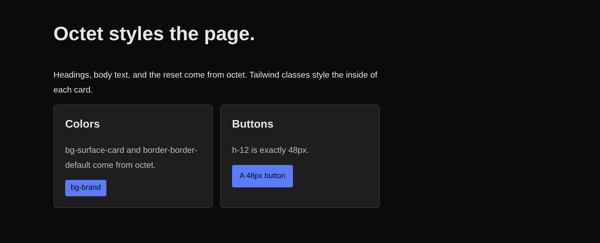
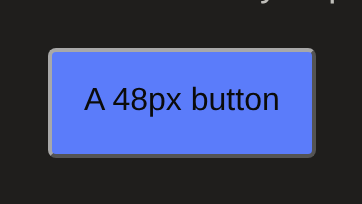
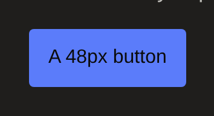
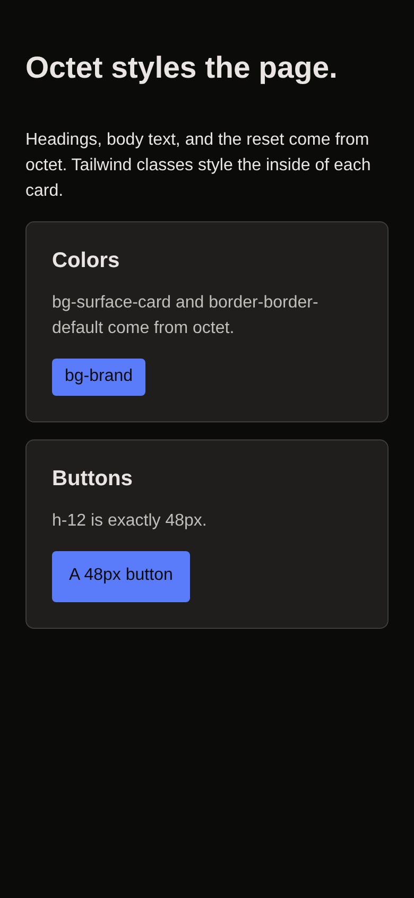

# Recipe: Tailwind v4 with Octet

Octet owns the page: the reset, type, spacing between blocks, and colors. Tailwind handles the inside of components. Both read the same tokens, so neither can drift from the other.

This recipe was built and tested with octet-scss 0.5.0 and Tailwind 4.3.



## Should you use both?

Octet works well by itself. Add Tailwind only if the trade-offs below suit your team.

**Good reasons to combine them**

- **What Octet adds.** Tailwind leaves three things to you: a vertical rhythm on an 8px grid, fluid headings that scale with the screen, and accessibility defaults like a focus ring, a skip link, and a reduced-motion reset. Octet supplies all three. This is the main reason to combine them.
- **Responsive by default.** Tailwind only responds where you add a prefix like `md:grid-cols-2` to an element. Octet sets the page-level scale for you: headings scale fluidly, block spacing steps up with the screen, and the page grid has fluid gutters. Tailwind then fine-tunes inside a component. Body copy stays a fixed size so it respects the reader's browser setting.
- **No second palette.** Octet's reset, links, and focus ring already use Octet's colors. The theme file makes Tailwind read the same ones, so you keep one palette instead of two. Tailwind alone also has one palette, so this isn't a reason to add Octet. It just keeps the two from drifting apart once you use both.
- **Speed while building components.** Octet ships only a few components, on purpose. Tailwind fills that gap: you build components with utilities for padding, flex, and grid, and Octet keeps the page-level rhythm.
- **Familiar to teams.** Many developers and AI coding tools already write Tailwind fluently.
- **No cascade fights.** The layer order means a utility always beats Octet, so you never need `!important`.

**Costs to know about**

- **Two philosophies.** Octet keeps styles in a central theme. Tailwind puts them in the HTML. Mixing them takes discipline, which is why the rules below exist.
- **An extra build step.** Sass runs first, then Tailwind. When Octet's tokens change, you rebuild.
- **Utilities can bypass Octet.** The same layer order that prevents fights also lets a one-off class override the system without anyone noticing.
- **Tailwind's reset is turned off.** Tailwind normally includes a reset (called Preflight) that strips the browser's default styles. This setup uses Octet's reset instead. It leaves a few defaults in place, like the border on buttons. Tailwind code copied from other sites may look slightly different until you adjust it.
- **Tested in Vite only.** It's verified in a standalone page and in a Vite project. Next.js and other frameworks haven't been tried.

**Skip Tailwind if** you want everything styled from Octet's theme.

### Does it add bloat?

Not much, if you load only what you use. Tailwind v4 builds only the classes it finds in your files, so its CSS stays small. Octet is built in layers, and you choose which ones to load:

| Octet layer | Raw | Gzipped |
| --- | --- | --- |
| `base` (reset, colors, accessibility, headings) | 5.2 KB | 1.5 KB |
| `utilities` | 9.8 KB | 1.2 KB |
| `starter-theme` (nav, footer, type) | 7.4 KB | 2.1 KB |
| `sections` | 4.2 KB | 0.9 KB |
| `pages` | 2.8 KB | 0.6 KB |
| `components` | 1.2 KB | 0.5 KB |

Here is the whole page, built three ways:

| Build | Size | Gzipped |
| --- | --- | --- |
| Tailwind alone | 6.3 KB | 2.0 KB |
| Octet (`base` + `utilities`) + Tailwind | 18.7 KB | 3.2 KB |
| Octet (everything) + Tailwind | 35.2 KB | 5.7 KB |

Step 2 below loads everything, because it's the simplest way to see Octet working. A real project is usually leaner. The starter theme is meant to be copied and customized, not imported (see the Octet README). To load only the reset, headings, and utilities, replace the contents of `my-project/src/octet.scss` with these three lines, then run `npm run build` again:

```scss
@use "pkg:octet-scss/abstracts";
@use "pkg:octet-scss/base";
@use "pkg:octet-scss/utilities";
```

The test page still renders the same: the same colors, a 48px button, and 24px card padding. The headings stay fluid, because they ship in `base`.

What combining does reduce is drift. Plain Tailwind lets a team scatter dozens of slightly different grays and spacings across a site. With Octet, only your colors exist, spacing steps land on the 8px grid, and breakpoints have one set of values.

It's a guardrail, not a lock. Tailwind's arbitrary values, like `mt-[13px]`, still work. This recipe's own test page uses `max-w-[1100px]`. A team that wants strict consistency should add a lint rule against them.

The test page is tiny. Real sites grow with every class they use, so treat these numbers as a floor. Measured with Octet 0.5.0 and Tailwind 4.3.

## What you end up with

- Tailwind color classes (`bg-brand`, `text-text-secondary`) point at Octet's custom properties. Change a color in your theme and both systems follow.
- Tailwind's default palette is gone. Only Octet's colors exist.
- `p-6` is 24px and `gap-4` is 16px. Every step lands on the 8px grid.
- `md` and `lg` match Octet's 720px and 900px breakpoints, so both systems reflow at the same width.
- Octet's reset replaces Tailwind's Preflight. Octet sits in a lower cascade layer, so a utility can override Octet, never the reverse.

## Setup

Using Vite? Skip to [Setup with Vite](#setup-with-vite-react--typescript). The steps below use Tailwind's command-line tool.

This takes about ten minutes. You'll create one folder, install four packages, make four files, edit one, and run one command.

### Before you start

You need Node.js installed. Open a terminal and run `node --version`. Any version from 20 up works.

### Step 1. Make the project folder and install the packages

In your terminal, run these three commands one at a time:

```sh
mkdir my-project
cd my-project
npm init -y
```

Then install the packages:

```sh
npm install -D octet-scss sass tailwindcss @tailwindcss/cli
```

You now have a folder called `my-project` with a `package.json` inside it. Every path below is relative to this folder. Create a folder named `src` inside it:

```sh
mkdir src
```

When you finish, the folder will look like this. The files marked "you create" are the ones in the steps below:

```
my-project/
├── package.json          (npm made it; you edit it in step 6)
├── index.html            (you create, step 5)
├── src/
│   ├── octet.scss        (you create, step 2)
│   ├── tailwind-theme.scss  (you create, step 3)
│   ├── app.css           (you create, step 4)
│   ├── octet.css         (the build makes it)
│   └── octet-tailwind.css   (the build makes it)
└── dist/
    └── app.css           (the build makes it. This is the file your page uses)
```

### Step 2. Create `my-project/src/octet.scss`

This file tells Sass to compile all of Octet into plain CSS. Create a new file at `my-project/src/octet.scss` and paste in this one line:

```scss
@use "pkg:octet-scss";
```

> **Why compile Octet?**
>
> Octet is written in Sass, a language that adds variables, functions, and loops to CSS. Browsers can't read Sass. They only read plain CSS. "Compiling" means running Sass once to turn Octet's `.scss` files into one plain `.css` file.
>
> Tailwind v4 has the same limit: it reads plain CSS, not Sass. So Octet has to be compiled first, and the CSS file it produces is what you hand to Tailwind in step 4.
>
> Octet's helpers, like `gridx()` and `rem()`, only run while Sass compiles, which happens when you build in step 7. They turn into ordinary numbers, so nothing from Sass reaches the browser.
>
> The `pkg:` in the line above tells Sass to look for `octet-scss` in your `node_modules` folder, where npm installed it.

### Step 3. Create `my-project/src/tailwind-theme.scss`

Tailwind v4 reads its theme from CSS. This file writes that theme from Octet's own tokens, so the two stay in sync. Create a new file at `my-project/src/tailwind-theme.scss` and paste in all of this:

```scss
@use "pkg:octet-scss/abstracts" as *;

// Octet's breakpoints have no names. Give them Tailwind's.
$tw-breakpoints: (sm: 540px, md: 720px, lg: 900px, xl: 1280px, 2xl: 1441px);

@theme inline {
  // Only octet's colors exist.
  #{"--color-*"}: initial;
  @each $ramp, $tones in $color-ramps {
    @each $tone, $value in $tones {
      --color-#{$ramp}-#{$tone}: var(--#{$ramp}-#{$tone});
    }
  }
  @each $role, $value in $semantic-colors {
    --color-#{$role}: var(--#{$role});
  }

  // Half the 8px grid: p-2 is 8px, p-4 is 16px.
  --spacing: #{$grid-base * 0.5};

  #{"--breakpoint-*"}: initial;
  @each $name, $width in $tw-breakpoints {
    --breakpoint-#{$name}: #{$width};
  }

  --font-sans: #{$font-family-sans};
  --font-serif: #{$font-family-serif};
  --radius-sm: #{$radius-sm};
  --radius-md: #{$radius-md};
  --radius-lg: #{$radius-lg};
  --radius-xl: #{$radius-xl};
}
```

`theme inline` matters. It makes `bg-brand` write `var(--brand)` instead of a copied color, so a color you override later in your own `:root` still works.

### Step 4. Create `my-project/src/app.css`

This file sets the layer order and pulls everything together. Create a new file at `my-project/src/app.css` and paste in all of this:

```css
/* Later layers win. Octet sits below Tailwind's utilities. */
@layer theme, base, octet, components, utilities;

@import "tailwindcss/theme.css" layer(theme);
/* No Preflight: Octet's reset does that job. */
@import "./octet.css" layer(octet);
@import "tailwindcss/utilities.css" layer(utilities);
@import "./octet-tailwind.css";

@source "../index.html";
```

The last line, `@source "../index.html";`, tells Tailwind which file to scan for classes. The path is relative to `src/app.css`, so `../index.html` means `my-project/index.html`. Later, when you have more files that use Tailwind classes, add one `@source` line for each.

### Step 5. Create `my-project/index.html`

This is a small test page. Create a new file at `my-project/index.html` and paste in all of this:

```html
<!doctype html>
<html lang="en">
<head>
  <meta charset="utf-8">
  <meta name="viewport" content="width=device-width, initial-scale=1">
  <title>octet + Tailwind</title>
  <link rel="stylesheet" href="dist/app.css">
</head>
<body>
  <main class="max-w-[1100px] mx-auto px-6 py-12">
    <h1>Octet styles the page.</h1>
    <p>Headings, body text, and the reset come from octet. Tailwind classes style the inside of each card.</p>
    <div class="grid gap-4 md:grid-cols-2 lg:grid-cols-3">
      <article class="bg-surface-card text-text-primary border border-border-default rounded-lg p-6">
        <h3>Colors</h3>
        <p class="text-text-secondary">bg-surface-card and border-border-default come from octet.</p>
        <span class="inline-block bg-brand text-text-on-brand rounded-md px-3 py-1">bg-brand</span>
      </article>
      <article class="bg-surface-card text-text-primary border border-border-default rounded-lg p-6">
        <h3>Buttons</h3>
        <p class="text-text-secondary">h-12 is exactly 48px.</p>
        <button class="bg-brand text-text-on-brand hover:bg-brand-hover rounded-md h-12 px-4 border-0 font-medium">A 48px button</button>
      </article>
    </div>
  </main>
</body>
</html>
```

### Step 6. Add the build commands to `my-project/package.json`

Open `my-project/package.json`. Find the `"scripts"` section. It looks like this:

```json
"scripts": {
  "test": "echo \"Error: no test specified\" && exit 1"
},
```

Replace that whole `"scripts"` section with this:

```json
"scripts": {
  "build:octet": "sass --pkg-importer=node src/octet.scss src/octet.css --no-source-map",
  "build:theme": "sass --pkg-importer=node src/tailwind-theme.scss src/octet-tailwind.css --no-source-map",
  "build:css": "tailwindcss -i src/app.css -o dist/app.css",
  "build": "npm run build:octet && npm run build:theme && npm run build:css"
},
```

Keep the comma after the closing brace if other settings follow it.

### Step 7. Build and open the page

In your terminal, from inside `my-project`, run:

```sh
npm run build
```

You should see `Done in` followed by a time, with no red error text. Now open `my-project/index.html` in your browser by double-clicking it. You should see two dark cards on a dark page, a blue button, and the heading in Octet's type. If you do, it's working.

Run `npm run build` again any time you change a Tailwind class in your HTML or a token in octet.

## Setup with Vite (React + TypeScript)

Vite compiles Sass for you and has an official Tailwind plugin, so there are fewer moving parts than the command-line setup above. Everything below was tested with Vite 8, in both the dev server and a production build.

### Before you start

You need a Vite project. If you don't have one, run these three commands one at a time:

```sh
npm create vite@latest my-vite-app -- --template react-ts
cd my-vite-app
npm install
```

Every path below is relative to the `my-vite-app` folder.

### Step 1. Install the packages

In your terminal, from inside `my-vite-app`, run:

```sh
npm install -D octet-scss sass tailwindcss @tailwindcss/vite
```

### Step 2. Create `my-vite-app/src/tailwind-theme.scss`

This is the same file as step 3 of the setup above: it writes Tailwind's theme from Octet's tokens. Create a new file at `my-vite-app/src/tailwind-theme.scss` and paste in all of this:

```scss
@use "pkg:octet-scss/abstracts" as *;

// Octet's breakpoints have no names. Give them Tailwind's.
$tw-breakpoints: (sm: 540px, md: 720px, lg: 900px, xl: 1280px, 2xl: 1441px);

@theme inline {
  // Only Octet's colors exist.
  #{"--color-*"}: initial;
  @each $ramp, $tones in $color-ramps {
    @each $tone, $value in $tones {
      --color-#{$ramp}-#{$tone}: var(--#{$ramp}-#{$tone});
    }
  }
  @each $role, $value in $semantic-colors {
    --color-#{$role}: var(--#{$role});
  }

  // Half the 8px grid: p-2 is 8px, p-4 is 16px.
  --spacing: #{$grid-base * 0.5};

  #{"--breakpoint-*"}: initial;
  @each $name, $width in $tw-breakpoints {
    --breakpoint-#{$name}: #{$width};
  }

  --font-sans: #{$font-family-sans};
  --font-serif: #{$font-family-serif};
  --radius-sm: #{$radius-sm};
  --radius-md: #{$radius-md};
  --radius-lg: #{$radius-lg};
  --radius-xl: #{$radius-xl};
}
```

### Step 3. Create `my-vite-app/src/octet.scss`

Create a new file at `my-vite-app/src/octet.scss` and paste in all of this:

```scss
@use "sass:meta";

// Vite compiles this file. The layer wrapper keeps Octet below Tailwind's utilities.
@layer octet {
  @include meta.load-css("octet-scss");
}
```

> **Why is this different from the setup above?**
>
> The command-line setup compiles Octet to a separate CSS file, then lets Tailwind put it in a layer. Here, Vite compiles Octet itself, so the layer has to be added in Sass. Sass doesn't allow `@use` inside a block, so `meta.load-css` does the same job.
>
> Notice the name is `"octet-scss"`, not `"pkg:octet-scss"`. Vite finds packages on its own, and the `pkg:` prefix only works in the command-line steps.

### Step 4. Replace the contents of `my-vite-app/src/index.css`

Vite's template put some starter styles in this file. Delete everything in it and paste in this:

```css
/* Later layers win. Octet sits below Tailwind's utilities. */
@layer theme, base, octet, components, utilities;

@import "tailwindcss/theme.css" layer(theme);
/* No Preflight: Octet's reset does that job. */
@import "tailwindcss/utilities.css" layer(utilities);
@import "./octet-tailwind.css";
```

There's no `@source` line here. The Vite plugin finds the files that use Tailwind classes on its own.

### Step 5. Replace the contents of `my-vite-app/src/main.tsx`

Delete everything in the file and paste in this:

```tsx
import { StrictMode } from 'react'
import { createRoot } from 'react-dom/client'
import './index.css'   // first: sets the layer order
import './octet.scss'
import App from './App.tsx'

createRoot(document.getElementById('root')!).render(
  <StrictMode>
    <App />
  </StrictMode>,
)
```

The order of the two style imports matters. `index.css` must come first, because it declares the layer order.

### Step 6. Replace the contents of `my-vite-app/vite.config.ts`

Delete everything in the file and paste in this:

```ts
import react from '@vitejs/plugin-react'
import tailwindcss from '@tailwindcss/vite'
import { defineConfig } from 'vite'

export default defineConfig({
  plugins: [react(), tailwindcss()],
})
```

### Step 7. Replace the contents of `my-vite-app/src/App.tsx`

This is a small test page. Delete everything in the file and paste in this:

```tsx
export default function App() {
  return (
    <main className="max-w-[1100px] mx-auto px-6 py-12">
      <h1>Octet styles the page.</h1>
      <p>Headings, body text, and the reset come from Octet. Tailwind classes style the inside of each card.</p>
      <div className="grid gap-4 md:grid-cols-2 lg:grid-cols-3">
        <article className="bg-surface-card text-text-primary border border-border-default rounded-lg p-6">
          <h3>Colors</h3>
          <p className="text-text-secondary">bg-surface-card and border-border-default come from Octet.</p>
          <span className="inline-block bg-brand text-text-on-brand rounded-md px-3 py-1">bg-brand</span>
        </article>
        <article className="bg-surface-card text-text-primary border border-border-default rounded-lg p-6">
          <h3>Buttons</h3>
          <p className="text-text-secondary">h-12 is exactly 48px.</p>
          <button className="bg-brand text-text-on-brand hover:bg-brand-hover rounded-md h-12 px-4 border-0 font-medium">A 48px button</button>
        </article>
      </div>
    </main>
  )
}
```

The template also made `my-vite-app/src/App.css`. Nothing uses it now, so delete it.

### Step 8. Add three lines to `my-vite-app/package.json`

Open `my-vite-app/package.json` and find the `"scripts"` section. It looks like this:

```json
"scripts": {
  "dev": "vite",
  "build": "tsc -b && vite build",
  "lint": "oxlint",
  "preview": "vite preview"
},
```

Add a comma after the last line, then add the three new lines, so it looks like this:

```json
"scripts": {
  "dev": "vite",
  "build": "tsc -b && vite build",
  "lint": "oxlint",
  "preview": "vite preview",
  "theme": "sass --pkg-importer=node src/tailwind-theme.scss src/octet-tailwind.css --no-source-map",
  "predev": "npm run theme",
  "prebuild": "npm run theme"
},
```

`predev` and `prebuild` run automatically before `npm run dev` and `npm run build`. They write `src/octet-tailwind.css` from Octet's tokens, so the theme is always current. Your own scripts may differ from the template's. Leave them as they are and just add the three new lines.

### Step 9. Run it

In your terminal, from inside `my-vite-app`, run:

```sh
npm run dev
```

Open the address it prints, usually `http://localhost:5173`. You should see two dark cards on a dark page, a blue button, and the heading in Octet's type. If you do, it's working.

To check a production build, run `npm run build`. You should see `built in` followed by a time, with no red error text.

## Rules for using both

1. **Octet owns the space between blocks.** Use Octet's spacing, not `mt-*` or `mb-*` utilities. Octet's rule is margin-bottom only, and utilities would break it.
2. **Tailwind owns the inside of components.** Padding, gap, grid, flex, color, radius.
3. **Use semantic colors.** Reach for `bg-surface-card` and `text-text-secondary` before the raw ramps like `bg-primary-500`.
4. **Check the 44px floor.** Tailwind doesn't enforce touch target size. See the button gotcha below.

## Two gotchas

Without Preflight, a few browser defaults come back. Both of these showed up in testing.

### Buttons keep the browser's border

Octet's reset doesn't remove the default border on `<button>`, and Preflight isn't there to do it. Add `border-0`, or use Octet's button styles.

### Padding doesn't set a control's height

Octet's line height adds to your padding, so `py-3` doesn't give you what the math says. Set the height directly.

| `px-4 py-3` | `h-12 px-4 border-0` |
| --- | --- |
|  |  |
| 54.7px tall | 48px tall |

48px clears the 44px target floor. 54.7px does too, but it's off the 8px grid.

## On a phone

Same page at 390px wide. The cards stack to one column at Octet's 720px breakpoint, because Tailwind's `md` is now 720px.



## Troubleshooting

**A utility has no effect.** Check that the file using it is listed in `@source`. Tailwind only builds classes it can find.

**Tailwind's default colors still work.** Check that `--color-*: initial;` is the first line inside `@theme`. It must come before the colors you add.

**Octet's styles override a utility.** Check the `@layer` line at the top of `app.css`. `utilities` must come after `octet`.

**`Can't find stylesheet to import`.** Add `--pkg-importer=node` to the Sass command, and use `pkg:` in the `@use` line.

**In Vite: `Can't find stylesheet to import`.** Use the plain name, `"octet-scss"`, in `src/octet.scss`. The `pkg:` prefix only works in the command-line steps.

## Status

Tested with Octet 0.5.0 and Tailwind 4.3, in a standalone page and in a Vite 8 project (React and TypeScript, dev server and production build). Next.js hasn't been tried. A generated `octet-tailwind.css` may ship with Octet in a later release, so you won't have to write the theme file yourself.
